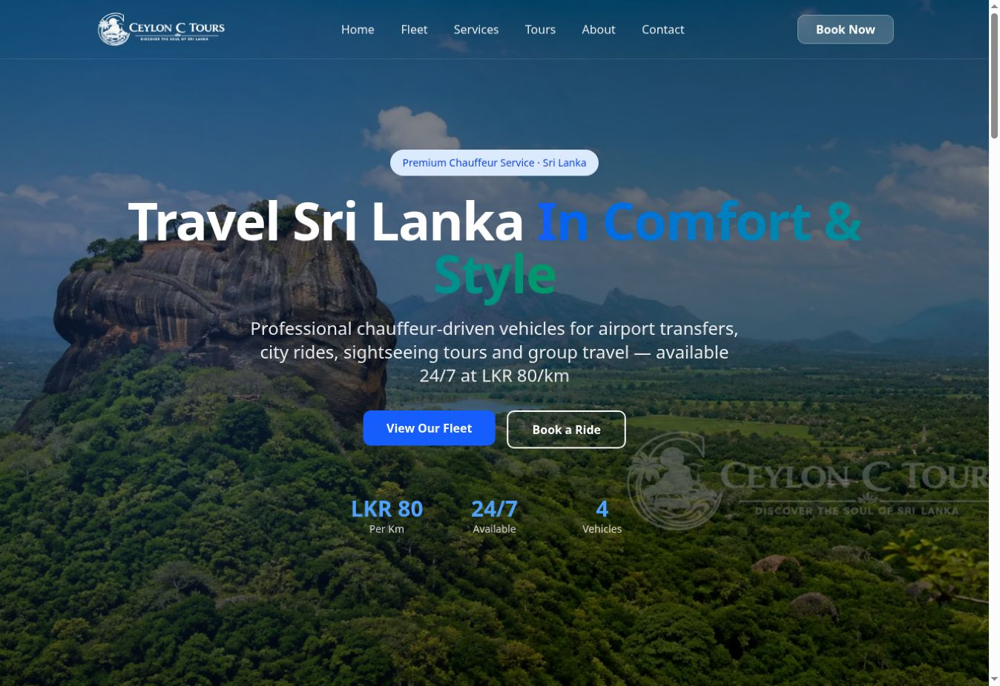
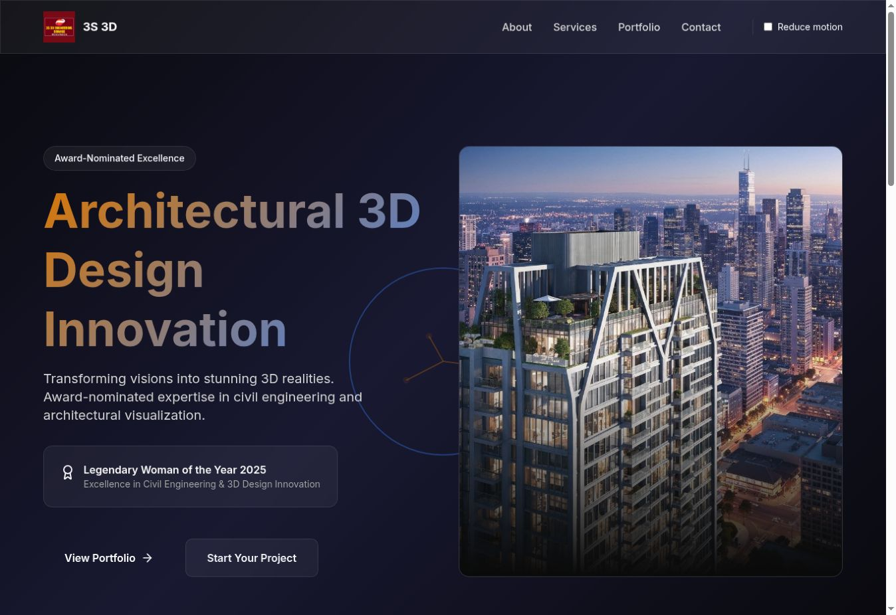
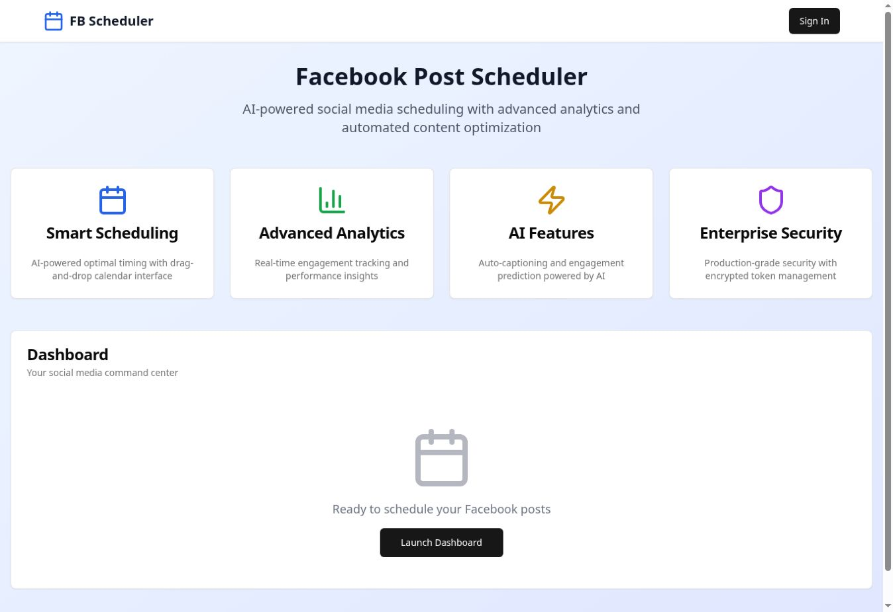

# Geeth Namal

**Web Developer · E-commerce Websites · Automation & AI Integrations**

Based in Sri Lanka · Working remotely

I build websites and practical digital tools for businesses and community organizations. My work includes travel and chauffeur platforms, fashion storefronts, nonprofit websites, and applications in development.

[Portfolio](https://gnsa171.github.io/Portfolio/) · [Discuss a project](mailto:dkgnsa171@gmail.com)

## Production websites

### [CeylonDrive](https://ceylondrive.com/)

A Sri Lankan travel platform connecting visitors with private chauffeur services, airport transfers, tour guides, vehicles, and destination information.

**Visible technology:** PHP routes, Bootstrap, jQuery, Google Maps.

### [Black Soul](https://blacksoul.lk/)

A distinctive streetwear and music storefront combining merchandise discovery with an artist-led brand experience.

**Visible technology:** Next.js, React, Vercel.

### [Vellora Fashion](https://vellorafashion.online/)

A fashion and lifestyle storefront with a curated visual identity spanning apparel, beauty, accessories, and editorial content.

**Visible technology:** Next.js, React, Vercel.

## In development

These are public development previews, separate from my production work.

| Project | Focus | Visible technology / hosting |
| --- | --- | --- |
| [Kasagala Young Buddhist Association](https://kasagala-yba.vercel.app/) | Community & nonprofit | React, Vite, Vercel |
| [Ceylon C Tours](https://ceylonctours.netlify.app/) | Chauffeur & tour services | Next.js, React, Netlify |
| [3S 3D Engineering Service](https://3s3d.netlify.app/) | Architecture & visualization | Next.js, React, Netlify |
| [Facebook Post Scheduler](https://facebookpostscheduler.vercel.app/) | Social media workflow | Next.js, React, Vercel |

Explore development previews

### Kasagala Young Buddhist Association

A community website for the Kasagala Young Buddhist Association, presenting its mission, charitable activities, programmes, and ways to participate.

### Ceylon C Tours

A chauffeur and car-rental website presenting Sri Lankan travel services, a vehicle fleet, and a clear path to ride enquiries.

### 3S 3D Engineering Service

A visual business website for architectural visualization and engineering services, built around project presentation and enquiry.

### Facebook Post Scheduler

A social media scheduling application in development, exploring a dashboard-led workflow for content planning and AI-assisted social tools.

Additional projects remain in private repositories and have not been publicly launched. Their source and unreleased details are not published here.

## What I can help with

- **Business websites:** responsive sites and interfaces tailored to a brand and its audience.
- **E-commerce experiences:** storefronts, product presentation, and shopping interfaces.
- **Automation:** focused Python utilities, file processing, document generation, and API integrations.
- **AI prototypes:** bounded LLM integrations and local AI workflows.
- **Existing applications:** scoped interface improvements, debugging, and maintenance.

## Tools & interests

**Web:** HTML, CSS, JavaScript, TypeScript, React, Next.js, PHP, Bootstrap

**Automation & development:** Python, Git, GitHub, API integrations

**Deployment experience:** Vercel, Netlify, GitHub Pages

**Current interests:** local LLMs, AI-assisted developer tools, and practical workflow automation

## Working together

I start by understanding the problem, defining the scope, and agreeing on deliverables. Send your goal, current website or tools, timeline, and budget range to [dkgnsa171@gmail.com](mailto:dkgnsa171@gmail.com).

[View portfolio](https://gnsa171.github.io/Portfolio/) · [Public repositories](https://github.com/GNSA171?tab=repositories)

Previews captured October 28, 2026. Technology labels describe publicly visible framework, asset, route, or hosting signals; private backend details and development feature claims are not independently audited.
