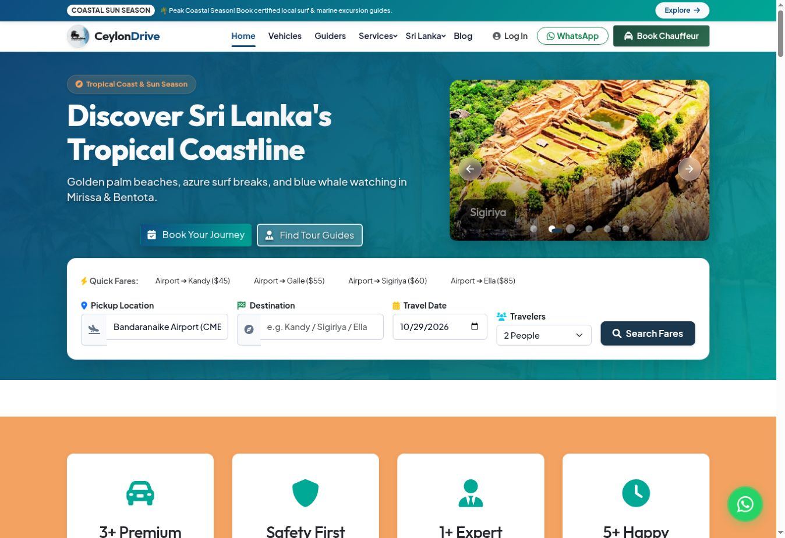
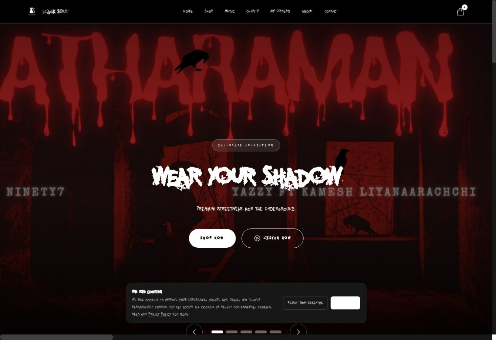
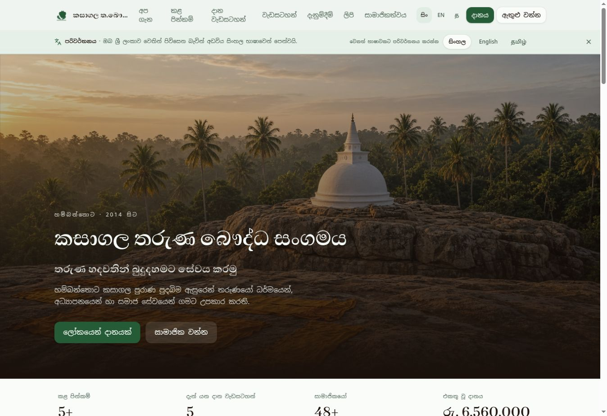

# Geeth Namal

### Software Engineer & Systems Architect · Full-Stack Web · Desktop Security & Local AI

📍 Based in Sri Lanka · Available for Remote Engineering Contracts & Technical Engagements  
🔗 [**Live Portfolio**](https://gnsa171.github.io/Portfolio/) · 📫 [**dkgnsa171@gmail.com**](mailto:dkgnsa171@gmail.com) · 💻 [**GitHub Profile**](https://github.com/GNSA171)

I design and build production-grade web platforms, high-assurance desktop security software, local AI systems, and resilient digital architectures. My engineering work bridges modern frontend architectures (React, Next.js 14, TypeScript, Three.js) with hardened backend services (Node.js, PHP 8.x MVC, FastAPI, Supabase/PostgreSQL), offline-first desktop systems (.NET 8 LTS, C#, AES-256-GCM, Argon2id), and privacy-preserving local edge AI pipelines (Ollama, Whisper, Frigate NVR, TensorFlow Lite).

---

## Technical Stack & Engineering Capabilities

### Languages & Frameworks

### Backend, Databases & Infrastructure

### Security, Cryptography & Edge AI

-000000?style=flat-square&logoColor=white)

---

## Core Engineering Disciplines

* **Full-Stack Web & E-Commerce:** Production Next.js 14 App Router, React 18/19, TypeScript, TanStack Start (SSR) & TanStack Router, Supabase (PostgreSQL with Row Level Security), PHP 8.x MVC, PayHere payment gateway, Three.js / React Three Fiber for 3D product customization, and real-time Socket.IO WebSockets.
* **Desktop Security, Cryptography & Systems:** C#, .NET 8 LTS, WPF (MVVM Architecture), true in-place authenticated AES-256-GCM chunked encryption, memory-hard Argon2id key derivation, write-through crash recovery journaling, PathGuard filesystem safety, and 100% offline portable single-file executables.
* **Local AI, Search & Edge Automation:** 100% local smart home ecosystems (Home Assistant, Mosquitto MQTT, Node-RED, Frigate NVR computer vision, Whisper STT / Piper TTS / Ollama local LLMs); private hybrid search engines fusing BM25 Okapi inverted indexing with dense vector embeddings and Tor circuit isolation; quantitative futures trading engines (Freqtrade, FreqAI, XGBoost).
* **Cross-Platform Mobile & Offline Storage:** Offline-first mobile applications built with Flutter and Dart, featuring on-device TensorFlow Lite DeepLabv3 semantic segmentation (GPU delegate) for intelligent text safe-zone detection; Android Jetpack Storage Access Framework (SAF) for persistent data retention.

---

## GitHub Activity & Codebase Metrics

  
  

  

---

## 🚀 Featured Production Platforms

### [CeylonDrive](https://ceylondrive.com/) — Full-Stack Tourism & Logistics Platform

An enterprise-grade travel logistics and chauffeur booking platform built for international tourists in Sri Lanka.
* **Stack:** PHP 8.x MVC, MySQL / MariaDB, Node.js + Socket.IO, Google Maps Distance Matrix API, Google Gemini 1.5 Flash AI, Telegram Bot API, WhatsApp Business, Bootstrap 5.3, Oracle Cloud VPS, Cloudflare CDN
* **Engineering Highlights:**
  * Dynamic airport transfer pricing engine computed via Google Maps Distance Matrix and route geometry.
  * Bespoke multi-day tour itinerary generator, chauffeur fleet directory, and live customer-driver chat powered by a Node.js Socket.IO microservice.
  * Automated dispatch alerts notifying verified drivers via Telegram Bot webhooks and pre-filled WhatsApp Business itineraries.
  * Autonomous Google Ads script powered by Google Gemini 1.5 Flash AI for real-time negative keyword mining and search term budget optimization.
  * Live 4.9★ Google Places API review synchronization; deployed on Oracle Cloud VPS with Apache 2.4 and Let's Encrypt SSL/TLS.

---

### [BLACK SOUL](https://blacksoul.lk/) — 3D Streetwear E-Commerce & Music Hub

An immersive direct-to-consumer streetwear e-commerce platform and music streaming hub built for underground hip-hop artist YAZZY.
* **Stack:** Next.js 14 App Router, React 18, TypeScript, Three.js / React Three Fiber (@react-three/drei), Supabase (PostgreSQL with RLS), Sanity v4 Headless CMS, PayHere Gateway, Tailwind CSS, Zustand, Vercel
* **Engineering Highlights:**
  * Interactive 3D merchandise customizer utilizing React Three Fiber and Three.js for 360° orbital product inspection and multi-zone decal placement across garment zones (chest, back, sleeves).
  * Persistent Web Audio streaming player with animated equalizer frequency visualizers, allowing uninterrupted music playback across site navigation.
  * Scalable backend built on Supabase (PostgreSQL) with Row Level Security (RLS) policies for catalogs, variant stock, and order lifecycles.
  * Hybrid payment processing integrating PayHere gateway, Bank Deposit QR code generation with slip upload verification, and Cash on Delivery (COD).
  * Headless Sanity v4 Studio with GROQ queries for editorial releases, paired with an automated 25% profit-split reporting dashboard dedicated to verified community charities.

---

### [Vellora Fashion](https://vellorafashion.online/) — Curated E-Commerce Storefront

A high-performance fashion and lifestyle e-commerce storefront presenting curated apparel, beauty, and accessories collections.
* **Stack:** Next.js, React, Tailwind CSS, Vercel Edge Network
* **Engineering Highlights:** Server-side rendered product catalogs, faceted search and category filtering, responsive shopping bag and wishlist state, and optimal Core Web Vitals.

---

### [Ceylon C Tours](https://ceylonctours.netlify.app/) & [3S 3D Engineering Service](https://3s3d.netlify.app/)
* **Ceylon C Tours:** Professional chauffeur and vehicle fleet presentation website built with Next.js, React, and Tailwind CSS, featuring curated Sri Lankan travel circuits and direct ride enquiry routing.
* **3S 3D Engineering Service:** Visual business website for an architectural visualization studio, showcasing 3D rendering galleries, Building Information Modeling (BIM) workflows, and international client consultation booking.

---

## 🔒 Systems, Security & Desktop Software

### SecureFolder Locker — Windows Authenticated Encryption Suite
* **Platform & Stack:** C#, .NET 8 LTS, WPF (MVVM Architecture), SQLite, Windows 10/11 x64
* **Security & Cryptography:**
  * True in-place authenticated encryption using **AES-256-GCM** in 64 KB authenticated chunks with unique per-chunk nonces. No plaintext filenames or file contents remain exposed on disk.
  * Memory-hard key derivation via **Argon2id** (64 MB memory, 4 iterations, 4 parallelism lanes) providing resistance against GPU/ASIC brute-force attacks.
  * Sub-second master password re-wrapping without needing to re-encrypt underlying stored files.
  * Write-through transaction journaling in SQLite for automatic crash detection and recovery, ensuring interrupted operations safely roll back without data corruption.
  * PathGuard safety engine strictly preventing locking critical Windows system roots, junctions, or binaries.
  * Packaged as a 100% offline, zero-knowledge, single-file portable Windows x64 executable requiring no installer, background services, or network connection.

### OpenSearch Intelligence Engine (OSIE) — Private Hybrid Search & Agents
* **Platform & Stack:** Python, FastAPI, React 18 / TypeScript, SQLite WAL, NumPy
* **Retrieval & AI Architecture:**
  * Robertson-Spärck Jones **BM25 Okapi** full-text inverted indexer with exact phrase boosting and document length normalization.
  * Dense semantic space representation using subword LSA and **Ollama neural embeddings** (384-dimensional) with NumPy cosine similarity fusion.
  * Autonomous research agent executing query decomposition into subquery trees, parallel retrieval, passage deduplication, and structured dossier synthesis into Markdown, JSON, and CSV.
  * Security layer incorporating strict SSRF validation blocking private IPv4/IPv6 CIDR blocks, with Tor onion crawling strictly isolated through local SOCKS5 proxy circuits to prevent DNS leaks.

### Smart Home OS — 100% Local Privacy-First Automation Platform
* **Platform & Stack:** Docker Compose, Home Assistant, Mosquitto MQTT, Node-RED, Frigate NVR, Whisper, Piper, Ollama, Zigbee2MQTT, Prometheus, Grafana
* **Systems Architecture:**
  * Commercial-grade smart home ecosystem running 100% locally on dedicated hardware with zero cloud dependencies or telemetry leaks.
  * Edge AI voice pipeline incorporating Whisper (speech-to-text), Piper (text-to-speech), and Ollama (local LLM reasoning and intent parsing).
  * Real-time computer vision object detection via Frigate NVR using hardware acceleration over RTSP cameras.
  * Unified Mosquitto MQTT message broker connecting Zigbee devices, environmental sensors, and multi-zone climate systems with telemetry exported to Prometheus and Grafana.

### QuantOps Algorithmic Trading Engine — Quantitative Futures Paper-Trading
* **Platform & Stack:** Python, Freqtrade, FreqAI, CCXT, XGBoost, LightGBM, Docker, Streamlit
* **Architecture:** Docker containerized quantitative trading engine with walk-forward adaptive feature training across multi-timeframe OHLCV data. Enforces strict paper-trading policies (`dry_run=true`, balance caps, automated trailing stop-losses) and automated configuration security audits.

### Buddhist Organization Governance Platform (BOGP) — Enterprise Systems Architecture
* **Platform & Stack:** PostgreSQL RLS, Multi-Tenant Architecture, Double-Entry Accounting, Domain-Driven Design, ABAC, WCAG 2.2 AA
* **Architecture:** Enterprise governance, double-entry fund accounting, and compliance system specification designed for community institutions, temples, and NGOs. Enforces strict role-based and attribute-based segregation of duties, PostgreSQL Row Level Security (RLS) tenant isolation, and tamper-evident audit trails.

---

## 📱 Mobile & Pre-Release Systems

### [Kasagala Young Buddhist Association](https://kasagala-yba.vercel.app/) — Community Governance Portal

A bilingual (Sinhala & English) community management and humanitarian fundraising platform in active staged rollout.
* **Stack:** TanStack Start (SSR), TanStack Router, React 19, TypeScript, Tailwind CSS v4, Radix UI, Better Auth, Dual Database Engine (PGlite local WASM / Neon PostgreSQL cloud), Recharts
* **Features:** Unique membership number assignment (`KYBA-YYYY-XXXX`) and annual fee tracking; multi-currency donation logging with receipt verification; humanitarian project tracking with fundraising goal meters; administrative back-office for committee auditing; and lightweight custom i18n engine with full Sinhala and English dictionaries.

### Dhamma Quotes — Offline AI Image Editor (Mobile)
An offline-first Android AI image editor that intelligently overlays bilingual (Sinhala & English) Dhamma reflections on photos.
* **Stack:** Flutter 3.32+, Dart 3.8+, TensorFlow Lite (DeepLabv3), GPU Delegate, Riverpod, sqflite, Android NDK
* **On-Device Intelligence:** Integrates an on-device TensorFlow Lite DeepLabv3 semantic segmentation model to detect image composition and identify optimal safe zones for text placement without sending photos to cloud APIs. Accelerated via OpenGL GPU delegates with background Dart isolates.

### [Facebook Post Scheduler](https://facebookpostscheduler.vercel.app/) — Social Media Workflow Tool
A social media management web application featuring a dashboard-driven workflow for calendar-based content planning, queue management, and automated publishing workflows built with Next.js, React, and Tailwind CSS.

---

## 💼 Engineering Services & Engagement Workflow

* **Full-Stack Web Applications:** High-performance Next.js and React platforms engineered for speed, search visibility, and maintainability.
* **E-Commerce Architecture:** Headless storefronts, interactive 3D WebGL merchandise customizers, secure payment gateways, and inventory management.
* **Desktop Security & Cryptography:** Custom Windows utilities built with C# / .NET 8 LTS, authenticated encryption, and zero-knowledge architectures.
* **Local AI, Private Search & Edge IoT:** On-premise LLM deployments, on-device computer vision, hybrid vector/full-text search engines, and smart home automation with zero recurring cloud API costs.
* **Cross-Platform Mobile Apps:** Offline-first Flutter/Dart and Kotlin Android applications with local database persistence and on-device machine learning.

### Engagement Lifecycle
1. **Understand & Scope:** Analyze system requirements, data schemas, performance bottlenecks, and security boundaries.
2. **Architect:** Define data contracts, authorization models, tech stacks, and milestone deliverables before implementation.
3. **Engineer & Verify:** Build with type safety, resilient error handling, unit/integration testing, and clean modularity.
4. **Deploy & Document:** Automated CI/CD pipelines, containerized deployment, and comprehensive technical runbooks.

---

## 📬 Let's Build Together

To discuss a software project, architecture consultation, or technical collaboration:

* 📧 **Direct Email:** [**dkgnsa171@gmail.com**](mailto:dkgnsa171@gmail.com)
* 🌐 **Live Portfolio:** [**https://gnsa171.github.io/Portfolio/**](https://gnsa171.github.io/Portfolio/)
* 💻 **GitHub:** [**https://github.com/GNSA171**](https://github.com/GNSA171)
